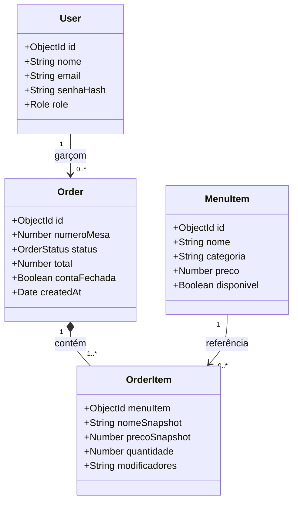
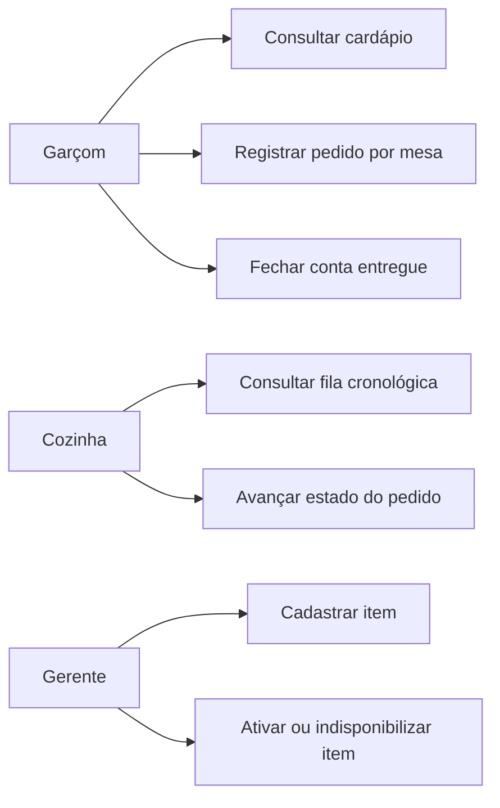
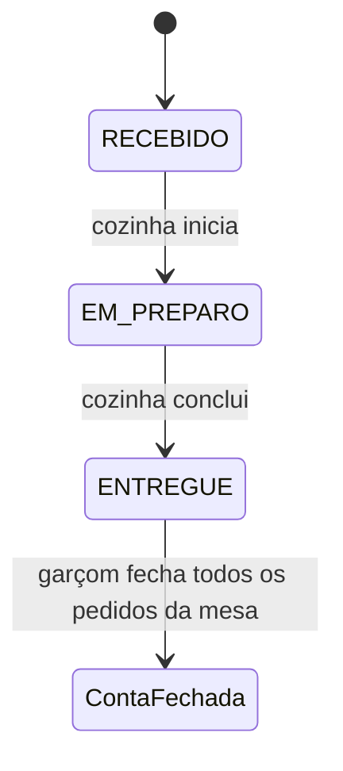

# Bistrô Dionísio

MVP de gestão de pedidos para o **Pequeno Bistrô Sabor Local**. O sistema substitui comandas de papel por pedidos digitais com fila cronológica para a cozinha e acompanhamento das contas por mesa.

## Público e escopo

- **Garçom:** consulta o cardápio disponível, registra pedidos por mesa, acompanha as contas e fecha a conta depois que todos os pedidos foram entregues.
- **Cozinha:** acompanha a fila do mais antigo para o mais recente e avança cada pedido de recebido para preparo e entregue.
- **Gerente:** cadastra itens e controla a disponibilidade sem apagar referências de pedidos anteriores.

### Regras do MVP

1. Cada pedido pertence a uma mesa e deve conter pelo menos um item disponível.
2. O servidor consulta os preços do cardápio e calcula o total; valores enviados pelo navegador não são aceitos como fonte de cobrança.
3. Uma conta reúne todos os pedidos ainda abertos da mesma mesa. Ela só pode ser fechada quando todos estiverem entregues.
4. Itens e preços são copiados para o pedido no momento do registro, preservando o histórico caso o cardápio mude.
5. Os perfis têm permissões distintas e usam uma sessão JWT em cookie `HttpOnly`.

## Como executar

Requisitos: Node.js, npm e MongoDB.

1. Instale as dependências com `npm install`.
2. Crie `.env.local` na raiz do projeto:

   ```env
   MONGODB_URI=mongodb://127.0.0.1:27017/bistro-dionisio
   JWT_SECRET=coloque-aqui-um-segredo-aleatorio-com-pelo-menos-32-caracteres
   ```

   Em produção, use um segredo forte gerenciado fora do repositório e uma conexão MongoDB protegida.

3. Popule o banco para a demonstração com `npm run db:seed`. O script cria/atualiza três usuários e inclui itens de exemplo. **Use apenas em ambiente local de demonstração:** ele redefine as senhas desses usuários para `admin123`.
4. Inicie o Next.js com `npm run dev` e acesse `http://localhost:3000`.

Contas locais:

| Perfil | E-mail |
|---|---|
| Garçom | `garcom@pequenobistro.com.br` |
| Cozinha | `cozinha@pequenobistro.com.br` |
| Gerente | `gerente@pequenobistro.com.br` |

Senha local para as três contas: `admin123`.

## Planejamento da solução

### Escopo e análise de risco

| Risco | Impacto | Mitigação no MVP |
|---|---|---|
| Pedido perdido ou fora da ordem | Alto | Persistência no MongoDB e ordenação cronológica da fila |
| Preço alterado no navegador | Alto | Total calculado na API a partir do cardápio |
| Item excluído quebrar pedido antigo | Médio | Desativação lógica e cópia de nome/preço no pedido |
| Conta fechada com itens ainda na cozinha | Alto | API recusa o fechamento enquanto houver pedido não entregue |
| Acesso indevido a operações | Alto | Cookie HttpOnly, expiração JWT e autorização por perfil na API |
| Queda de rede ou banco indisponível | Médio | Mensagens de erro visíveis; atualizar a tela para tentar novamente |

Fora do escopo desta versão: pagamentos integrados, impressão fiscal, estoque, divisão de conta e atualização instantânea por WebSocket. A cozinha atualiza a fila automaticamente a cada 10 segundos.

### Diagrama de classes



### Casos de uso



### Fluxo do pedido e da conta



## Verificação manual do MVP

1. Entrar em cada perfil e confirmar que áreas e ações são específicas do papel.
2. No gerente, adicionar item, indisponibilizá-lo e reativá-lo; confirmar que o salão só lista itens disponíveis.
3. No salão, montar pedido para uma mesa; confirmar que aparece primeiro na fila da cozinha e que o total corresponde ao preço do cardápio.
4. Tentar fechar a conta antes da entrega; o sistema deve bloquear a operação.
5. Na cozinha, avançar o pedido pelas etapas; confirmar que pedidos mais antigos aparecem primeiro.
6. Fechar a conta da mesa depois que todos os pedidos forem entregues; confirmar o total, a remoção da conta da lista aberta e o bloqueio de novos updates naquela comanda.
7. Tentar abrir APIs sem sessão ou com outro perfil; confirmar respostas `401`/`403`.

## Comandos

- `npm run dev`: ambiente de desenvolvimento
- `npm run lint`: análise estática
- `npm run build`: build de produção
- `npm run db:seed`: dados de demonstração local
